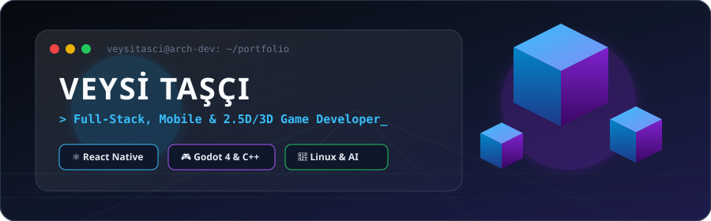

<div align="center">

  <!-- SENİN OLUŞTURDUĞUN 3D İZOMETRİK BANNER -->
  

  <br/><br/>

  <!-- DAKTİLO EFEKTLİ DİNAMİK UNVAN -->
  <a href="https://github.com/Veysitasci">
    
  </a>

  <br/>

  <!-- KIRILMAYAN MODERN ROZETLER -->
  <a href="https://github.com/Veysitasci?tab=followers">
    
  </a>
  <a href="https://github.com/Veysitasci?tab=repositories">
    
  </a>
  <a href="https://github.com/Veysitasci">
    
  </a>

</div>

<br/>

---

### 🧊 3D Sistem Mimarisi & Profil Özeti

```yaml
Geliştirici : "Veysi Taşcı (@Veysitasci)"
Odak_Alanları:
  Mobil_Web : ["React Native", "Expo", "TypeScript", "Node.js", "Python"]
  Oyun_Dev  : ["Godot 4.x", "C++ (GDExtension)", "2.5D İzometrik Sistemler"]
  UI_UX     : ["Bento Grid", "Glassmorphism", "SVG & Lottie Animasyon"]
  Altyapı   : ["Linux (Ubuntu / Kali)", "Docker", "Nginx", "PostgreSQL"]
Vizyon      : "Yüksek performanslı mimarileri modern tasarımla birleştirmek."
