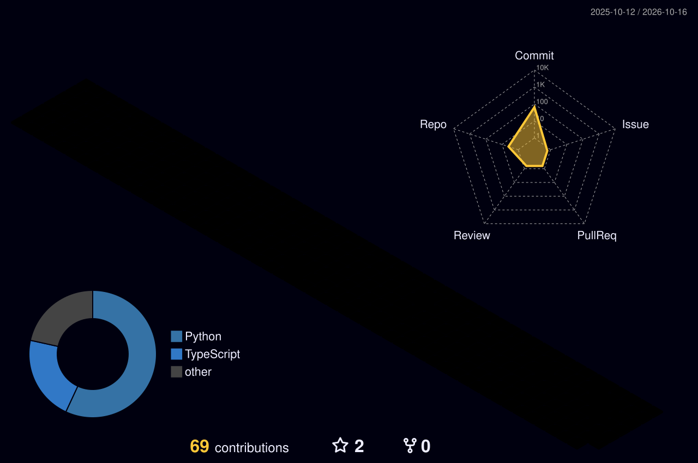
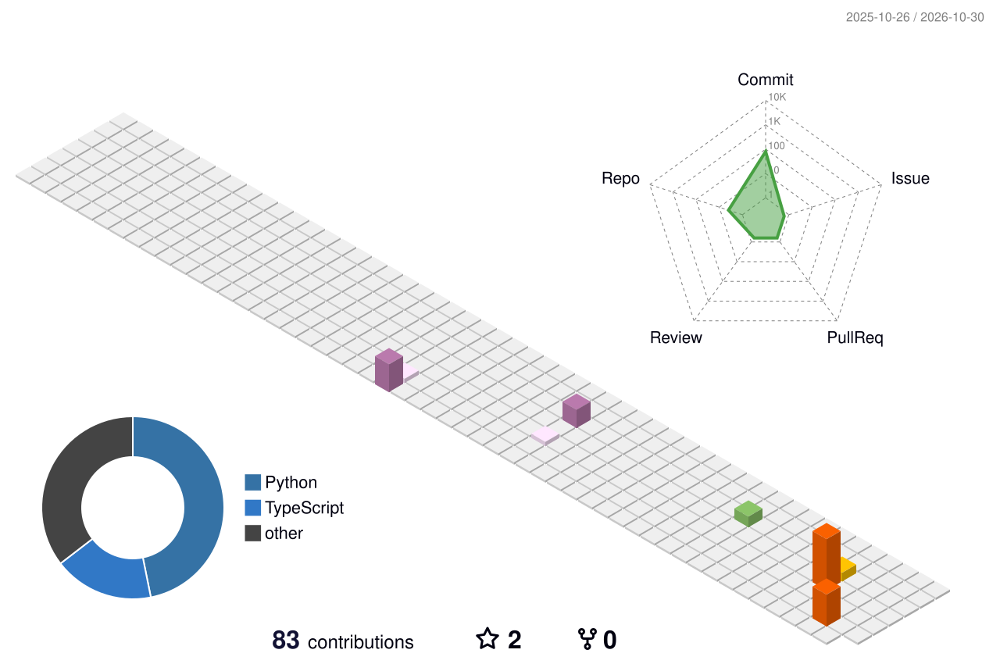
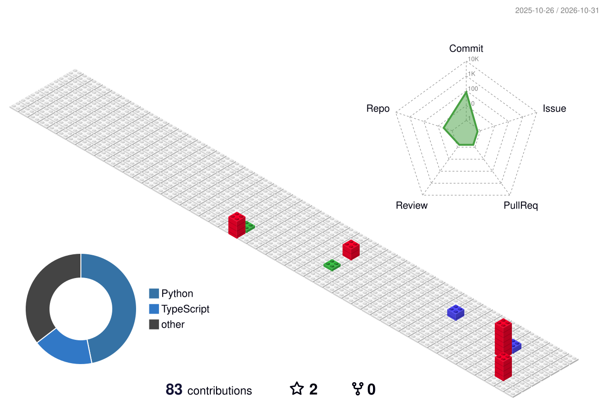
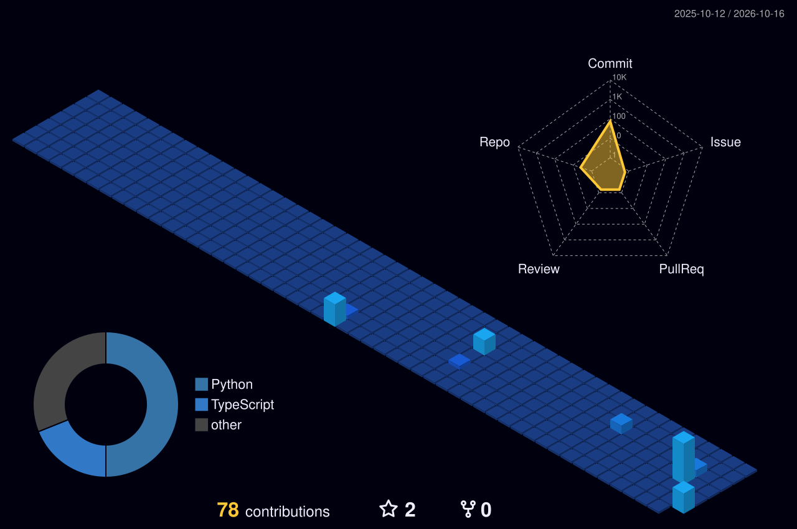

  <!-- 🌐 GERÇEK DİL DEĞİŞTİRME BUTONLARI -->
  

    
    
  

  <!-- 🧊 3D BANNER (Tek satır link - Resim olarak açılmaz) -->
  

    

  <!-- ⌨️ DAKTİLO EFEKTLİ ALT BAŞLIK -->
  

   

  <!-- 🎯 ÜST HIZLI MENÜ & UZMANLIK BUTONLARI -->
  

    
    
    
    
  

  <!-- 📊 CANLI TAKİPÇİ & YILDIZ BUTONLARI -->
  

    
    
  

---

### 🧊 Sistem Mimarisi & Geliştirici Profili

~~~yaml
Geliştirici    : "Veysi Taşcı (@Veysitasci)"
Marka_Kimliği  : "Dolunay Digital"
Odak_Alanları  :
  Mobil_ve_Web : ["React Native", "Expo", "TypeScript", "Node.js", "Express", "Python"]
  Oyun_Motoru  : ["Godot 4.x", "C++ (GDExtension)", "2.5D İzometrik Strateji Sistemleri"]
  Tasarım_UI_UX: ["Bento Grid", "Glassmorphism", "Özel SVG & Lottie Animasyonları"]
  Sistem_DevOps: ["Kali & Ubuntu Linux", "Docker", "Nginx", "PostgreSQL", "SQLite"]
Vizyon         : "Yüksek performanslı yerel (native) mimarileri modern 3D/UI estetiğiyle birleştirmek."
~~~

---

### 🛠️ İnteraktif 3D Teknoloji Vitrinim (Her İkona Tıklanabilir)

#### 🌐 Frontend, Mobil & UI Tasarım

  
  
  
  
  
  

#### ⚙️ Backend, Veritabanı & API Mimarisi

  
  
  
  
  
  

#### 🎮 Oyun Geliştirme, Linux & DevOps Araçları

  
  
  
  
  
  
  
  
  
  

---

### 🏙️ İnteraktif 3D İzometrik Katkı Şehri (Görünüm Modunu Seç)

> *Aşağıdaki sekmelere tıklayarak 3D katkı şehrinin temasını değiştirebilir, grafiğin üzerine tıklayarak doğrudan aktivite özetine gidebilirsin:*

<b>🌈 Mod 1: Neon Rainbow 3D Şehir (Varsayılan)</b>

  

<b>🎬 Mod 2: Canlı Animasyonlu 3D Yükselen Şehir (Animated 3D)</b>

  

<b>🧱 Mod 3: 3D Lego / Minecraft Blok Görünümü (GitBlock 3D)</b>

  

<b>🌌 Mod 4: Siber Gece Mavisi (Cyber Night 3D)</b>

  

---

### 📊 İnteraktif İstatistikler & Dil Filtreleri

  <!-- 🔥 TIKLANABİLİR DİL FİLTRE BUTONLARI (Tıklandığında o dildeki repoları açar) -->
  

    
    
    
    
  

  <!-- 📊 STREAK VE TOP LANGS KARTLARI (Tek satır link - Resim açılmaz, repolara gider) -->
  
  

 

---

### 📈 3D Neon Aktivite Dalgaları & Hızlı Navigasyon

  <!-- ⚡ AKTİVİTE HIZLI AKSİYON BUTONLARI -->
  

    
    
    
  

  <!-- 📈 NEON AKTİVİTE GRAFİĞİ (Tek satır link - Resim olarak açılmaz) -->
  

  <!-- 🌊 3D DALGALI FOOTER (Tek satır link - Tıklanınca en üste kaydırır) -->
  

